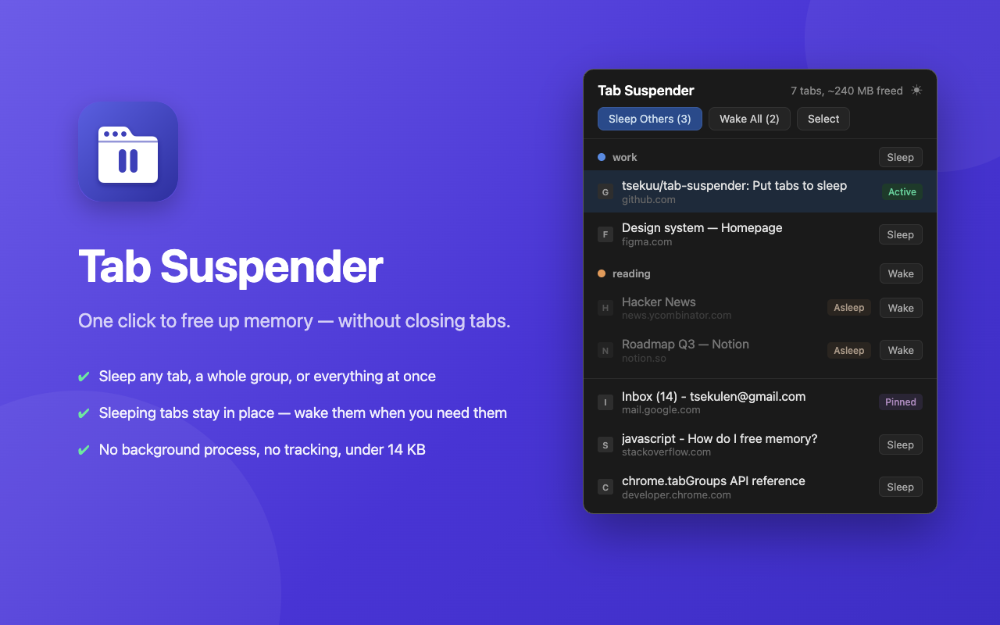

# Tab Suspender

A minimal Chrome/Brave browser extension (Manifest V3) for manually putting tabs to sleep to free up memory without closing them.

[**➜ Install from the Chrome Web Store**](https://chromewebstore.google.com/detail/bfnnjnpffmmffhpodkcmageobbdapdkc)



## Demo

https://github.com/user-attachments/assets/a2910bf5-6f64-429c-a00a-19a95d994272

## Features

- **Put individual tabs to sleep** — discard any inactive tab from the popup list
- **Sleep Others** — one-click discard of all non-active, non-pinned, non-audible tabs
- **Sleep by group** — the list is organized by tab group (name and color), with a one-click Sleep button per group
- **Select mode** — pick multiple tabs and put them to sleep in one go
- **Wake All** — restore every sleeping tab in the current window
- **Freed memory estimate** — the stats line shows a rough figure for memory reclaimed by sleeping tabs
- **Live tab list** — shows titles, hostnames, favicons, and status badges (Active / Asleep / Pinned / Playing)
- **Click to switch** — click any tab row to jump to it

## Small by design

Minimalism is the differentiator, and it's measurable:

- **No background process.** There is no service worker — when the popup is closed, the extension is not running at all. Zero idle memory, zero idle CPU. The extension uses less memory than one of the tabs it puts to sleep.
- **Under 14 KB installed.** Around 800 lines of vanilla JavaScript and CSS in three files — smaller than most single images on the web.
- **Zero dependencies, no build step.** What you see in this repo is exactly what runs in your browser.
- **Fast.** The popup fully renders a 200-tab window in under 5 ms — quicker than one frame of a 60 fps animation.
- **Native mechanism.** Sleeping uses Chrome's own tab discarding — the same thing Chrome does under memory pressure — with no machinery layered on top.
- **Minimal footprint.** Two permissions (`tabs`, `tabGroups`), no host permissions, no network requests, no data collection.

## Install

Install from the [Chrome Web Store](https://chromewebstore.google.com/detail/bfnnjnpffmmffhpodkcmageobbdapdkc), or load it unpacked for development:

1. Clone this repository:

   ```bash
   git clone https://github.com/Tseku210/tab-suspender.git
   ```

2. Open `chrome://extensions` (or `brave://extensions`)
3. Enable **Developer mode**
4. Click **Load unpacked** and select the cloned folder

## Files

- `manifest.json` — extension manifest (MV3)
- `popup.html` / `popup.js` — popup UI and tab management logic
- `icons/` — extension icons
